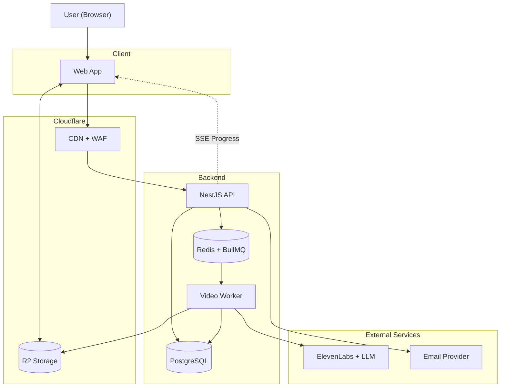
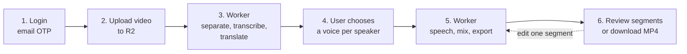

# Dubbio

## What is *Dubbio* ?

- Dubbio is a studio workflow platform that automates the dubbing pipeline while keeping the studio in full
  control of the output.
- The studio builds a private voice library from recordings of their own voice actors once. From that point,
    any foreign video can be dubbed using those exact voices, with the studio reviewing every line and approving it before downloading the final video.

## How it works ?

`From uploading to get dubbed video:`

1. Login: The web app asks the API for an email OTP, the user enters it, and the API returns a token (JWT). Users and sessions  live in PostgreSQL.

2. Voice (optional): The user uploads a voice sample. The API sends it to ElevenLabs, receives a voice_id, and saves it in Postgres.

3. Create project: The user chooses a video and the target language. The API creates a project row (status: uploading) and returns a presigned upload URL.

4. Upload: The browser uploads the video straight to Cloudflare R2, in chunks "segments", so it can resume if the connection drops. The video never passes through your API.

5. Start processing: The browser tells the API “upload finished”. The API checks the file, sets the status to queued, puts a job in Redis, and answers immediately. The user sees “Processing”.

6. Worker, part 1. The worker takes the job and runs the steps one by one:
    - separate voices from background music
    - transcribe and detect speakers
    - analyze context (scene, who talks to whom, emotion)
    - translate

        **Every step reads its input from R2/PostgreSQL, calls ElevenLabs/LLM/ffmpeg, saves its output, and updates its status.**

7. Live progress: Each status change is pushed to the user’s browser by the API (SSE), so the user watches “Transcribing… Translating…” instead of waiting blindly.

8. Choose voices (pause): After translation, the project status becomes "needs voices". The user sees the detected speakers (characters) and chooses a voice from the studio's voice library for each one. The API saves these choices.

9. Worker, part 2. After the user confirms the voices, the worker:
    - generates speech for each segment, in parallel
    - fits each segment to its original timing
    - mixes the new voices with the background audio
    - exports the final MP4 to R2
    - sets the status to completed

10. Review or download: When the project is completed, the user can choose:
    - **Review segments (chunks):** listen to each segment, edit a translated line or change its voice. The worker regenerates only that segment and re-exports.
    - **Download:** the API gives a short-lived download link, and the browser downloads the MP4 directly from R2.

**If a step fails, the worker retries it automatically. If it still fails, the project shows an error and the user can press “retry”, which resumes from the failed step and doesn’t start over.**

## 1. System diagram

- **API** answers fast and never does heavy work.
- **Worker** runs the slow dubbing steps in the background.
- **R2** stores the videos and audio. The browser uploads and downloads directly, not through the API.

## 2. End-to-end flow

## 3. Components

| Component | Responsibility | Technology |
| --- | --- | --- |
| Web app | Login, upload, progress, voice selection, segment review and edit, download | Frontend team's choice |
| Cloudflare CDN + WAF | Serves the web app, protects and proxies the API | Cloudflare |
| API | Auth, projects, voices, presigned URLs, progress (SSE). Answers fast, never does heavy work | NestJS, REST |
| Redis + BullMQ | Job queue, rate limits, cache | Redis |
| Worker | Runs pipeline steps in the background. Each step is saved and can be retried | Node.js, ffmpeg |
| PostgreSQL | Users, voices, projects, characters, segments, step outputs and status | PostgreSQL, Prisma |
| R2 | Original videos, audio files, final MP4 | Cloudflare R2 |
| AI providers | Voice cloning, transcription with speakers, translation, speech | ElevenLabs, LLM (behind interfaces) |
| Email provider | Sends OTP codes | Any transactional email service |
| CI/CD | Lint, typecheck, tests, build image, deploy to staging | GitHub Actions, Docker |
| Observability | Errors, logs with job IDs, queue dashboard | Sentry, pino, Bull Board |

## 4. Project status lifecycle

`uploading` → `queued` → `processing` → `needs_voices` → `rendering` → `completed`

Any step can move the project to `failed`. A retry resumes from the failed step. From `completed`, editing a segment sends the project back to `rendering` for that segment only, then it returns to `completed`.

## 5. Key design decisions

- **Modular monolith:** two processes (API and worker) from one codebase, not microservices.
- **Direct upload and download with R2:** large files never pass through the API, which helps slow connections.
- **Background jobs:** the API only enqueues, and workers do the slow work.
- **Every step saved:** each step's output goes to PostgreSQL/R2, so a failed step is retried alone and one edited segment is regenerated alone.
- **Voice choice before speech generation:** the user assigns a voice to each speaker after translation, before any speech is generated.
- **Review after rendering:** the user can review segments, edit a line or voice, and regenerate only that segment, or download the result.
- **Providers behind interfaces:** ElevenLabs and the LLM can be swapped, and mocks are used in dev and CI.
- **Hosting:** EU region behind Cloudflare, close to both Egypt and the AI providers.

## 6. Non-functional requirements

Targets are proposals for the MVP. Confirm them after the Sprint 0 spikes.

| Area | Requirement | Target |
| --- | --- | --- |
| Input limits | Video format, length, size | MP4 only, max 3 min, max 500 MB |
| Languages | Supported pair | One language pair, one direction |
| Processing time | Dubbing a full video | Under 10 minutes for a 3-minute video (measure in spikes) |
| API speed | Normal requests (not upload) | p95 under 500 ms |
| Progress | Status change visible to the user | Within about 2 seconds (SSE) |
| Upload | Slow or unstable connections | Resumable in parts, continues after a dropped connection |
| Reliability | Job safety | No lost jobs after a restart, 3 automatic retries, resume from the failed step |
| Availability | Uptime | Best effort, but stable on demo days |
| Cost control | AI spend | Per-user monthly minutes quota, global monthly spend cap, alert at 80% |
| Authentication | OTP and tokens | OTP expires in 5 minutes, max 5 attempts, rate-limited. Short-lived access token plus refresh token |
| Access control | Data separation | A studio can only see its own voices, projects and files |
| File access | Presigned URLs | Upload URL expires in 1 hour, download URL in 15 minutes |
| Upload validation | Reject bad files | Check type, size and duration before queuing |
| Voice consent | Cloning a voice | The user confirms they have the speaker's consent |
| Data retention | Cleanup | Deleting a project deletes its files and rows. Intermediate files are removed after 30 days |
| Backups | Data safety | Nightly PostgreSQL backup to R2, kept 7 days, restore tested once before the demo |
| Observability | Debugging | Structured logs with project and job IDs, Sentry, queue dashboard, health endpoint |
| Maintainability | Code quality | CI passes (lint, typecheck, tests), provider mocks in dev and CI, OpenAPI kept up to date |
| Scalability | Growth | Not needed beyond the demo. Workers can be added later, and the database is a single instance for now |
