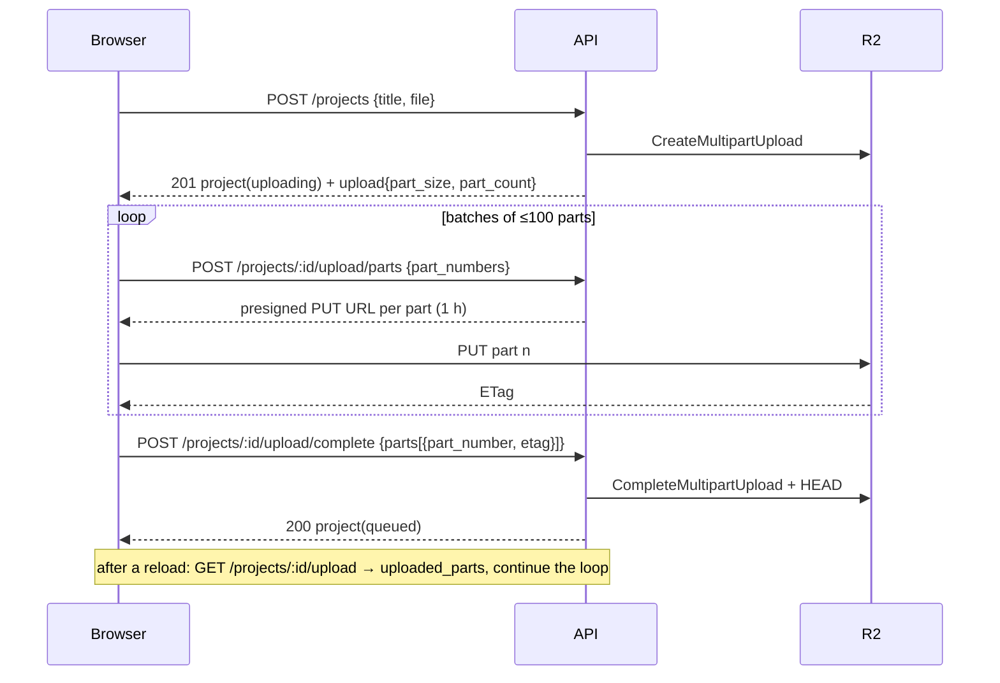

# Dubbio — 03 REST API

Base URL `https://api.dubbio.example/v1`, served behind Cloudflare. All names match `02-database.md`.
OpenAPI is generated from the NestJS decorators and served at `/v1/docs` outside production.

## 0. Endpoint index

| Module | Method | Path | Auth |
|---|---|---|---|
| Auth | POST | `/auth/otp/request` | public |
| Auth | POST | `/auth/otp/verify` | public |
| Auth | POST | `/auth/refresh` | refresh cookie |
| Auth | POST | `/auth/logout` | user |
| Me | GET | `/me` | user |
| Studio | GET | `/studio` | user |
| Studio | PATCH | `/studio` | user |
| Studio | GET | `/studio/usage` | user |
| Voices | POST | `/voices/uploads` | user |
| Voices | POST | `/voices` | user, idempotent |
| Voices | GET | `/voices` | user |
| Voices | GET | `/voices/:voice_id` | user |
| Voices | PATCH | `/voices/:voice_id` | user |
| Voices | DELETE | `/voices/:voice_id` | user |
| Voices | POST | `/voices/:voice_id/retry` | user, idempotent |
| Voices | GET | `/voices/:voice_id/sample` | user |
| Projects | POST | `/projects` | user, idempotent |
| Projects | GET | `/projects` | user |
| Projects | GET | `/projects/:project_id` | user |
| Projects | PATCH | `/projects/:project_id` | user |
| Projects | DELETE | `/projects/:project_id` | user |
| Projects | GET | `/projects/:project_id/upload` | user |
| Projects | POST | `/projects/:project_id/upload/parts` | user |
| Projects | POST | `/projects/:project_id/upload/complete` | user, idempotent |
| Projects | POST | `/projects/:project_id/upload/abort` | user |
| Projects | POST | `/projects/:project_id/retry` | user, idempotent |
| Projects | GET | `/projects/:project_id/steps` | user |
| Characters | GET | `/projects/:project_id/characters` | user |
| Characters | PATCH | `/projects/:project_id/characters/:character_id` | user |
| Characters | PUT | `/projects/:project_id/characters/:character_id/voice` | user |
| Characters | POST | `/projects/:project_id/characters/merge` | user |
| Characters | POST | `/projects/:project_id/voices/confirm` | user, idempotent |
| Segments | GET | `/projects/:project_id/segments` | user |
| Segments | GET | `/projects/:project_id/segments/:segment_id` | user |
| Review | GET | `/projects/:project_id/review` | user |
| Review | PATCH | `/projects/:project_id/review/segments/:segment_id` | user |
| Review | PATCH | `/projects/:project_id/review/segments` | user |
| Review | POST | `/projects/:project_id/review/segments/:segment_id/edit` | user, idempotent |
| Review | GET | `/projects/:project_id/review/segments/:segment_id/versions` | user |
| Review | POST | `/projects/:project_id/review/segments/:segment_id/revert` | user, idempotent |
| Review | POST | `/projects/:project_id/review/segments/:segment_id/versions/:version_id/retry` | user, idempotent |
| Review | POST | `/projects/:project_id/review/characters/:character_id/voice` | user, idempotent |
| Exports | GET | `/projects/:project_id/exports` | user |
| Exports | POST | `/projects/:project_id/exports` | user, idempotent |
| Exports | GET | `/projects/:project_id/download` | user |
| Events | POST | `/events/ticket` | user |
| Events | GET | `/events` | SSE ticket |
| Ops | GET | `/health`, `/health/ready` | public |
| Ops | — | `/admin/queues` (Bull Board) | basic auth, not public |

Diagram mapping: `/send-otp` → `POST /auth/otp/request`; `/signin` → `POST /auth/otp/verify` (creates studio + user on first sign-in); `/google` → not in MVP.

## 1. Conventions

### 1.1 Authentication
- **Access token**: JWT, 15 min, `Authorization: Bearer <token>`. Claims: `sub` (user_id), `studio_id`, `exp`, `jti`.
- **Refresh token**: opaque 32-byte random, stored hashed in `sessions`, delivered as an `HttpOnly; Secure; SameSite=Strict; Path=/v1/auth` cookie named `dubbio_rt`, 30 days, rotated on every refresh (reuse of a rotated token revokes all sessions of the user).
- **SSE**: `EventSource` cannot send headers, so `GET /events` takes a one-time ticket (§9).
- "user" auth means a valid access token. There are no roles in MVP; every studio-owned resource is scoped by `studio_id` from the token. A resource that belongs to another studio returns **404**, never 403 (no id enumeration).

### 1.2 Responses and errors
- JSON, snake_case, timestamps ISO-8601 UTC, ids UUID.
- Success: the resource, or `{ "data": [...], "next_cursor": "..." | null }` for lists.
- Error body:
```json
{ "error": { "code": "invalid_state", "message": "Project is not in needs_voices", "details": { "status": "rendering" } } }
```

| HTTP | code | when |
|---|---|---|
| 400 | `validation_error` | body/query fails validation; `details.fields[]` |
| 401 | `unauthenticated` | missing/expired token, bad OTP, bad refresh |
| 403 | `quota_exceeded` | monthly minutes or voice slots; `details.quota` |
| 403 | `regeneration_limit_reached` | `projects.regeneration_limit` hit |
| 404 | `not_found` | also for other studios' resources |
| 409 | `invalid_state` | operation not allowed in the current status; `details.status` |
| 409 | `segment_busy` | a version is already in flight for that segment |
| 409 | `voice_in_use` | voice delete while it is being used |
| 409 | `idempotency_conflict` | same `Idempotency-Key`, different body |
| 413 | `payload_too_large` | declared size over the limit |
| 429 | `rate_limited` | `Retry-After` header set |
| 500 | `internal` | unexpected; Sentry id in `details.ref` |

### 1.3 Pagination
Cursor-based on `(created_at desc, id desc)`: `?limit=20&cursor=<opaque>`; `limit` 1–100, default 20. Segments are not paginated (a 3-minute video has well under 500).

### 1.4 Idempotency
Endpoints marked *idempotent* accept `Idempotency-Key: <uuid>` (required for `POST /projects`, optional elsewhere). Scope `(user_id, key)`, kept 24 h in Redis with the response and a body hash. Same key + same body → the stored response (status and body) is replayed; same key + different body → `409 idempotency_conflict`.

### 1.5 Rate limits (Redis sliding window; headers `X-RateLimit-Limit`, `X-RateLimit-Remaining`, `Retry-After`)

| Scope | Limit |
|---|---|
| `POST /auth/otp/request` | 3 / 10 min per email, 10 / h per IP |
| `POST /auth/otp/verify` | 5 attempts per code (DB), 20 / h per IP |
| `POST /auth/refresh` | 30 / h per session |
| All authenticated routes | 300 / min per user |
| `POST /projects/:id/upload/parts` | 60 / min per project |
| `POST /review/.../edit`, `/revert`, `/review/characters/.../voice` | 30 / min per user, plus the project regeneration limit |
| `POST /events/ticket` | 20 / min per user |

### 1.6 Limits (config, defaults)
Video: `video/mp4` only, ≤ 500 MB, ≤ 180 s (duration is checked by the worker in `validate`). Voice sample: `audio/wav`, `audio/mpeg`, `audio/mp4`, ≤ 25 MB (confirm against the ElevenLabs IVC sample limits in the spike). `translated_text` ≤ 500 characters.

## 2. Resource shapes

```jsonc
// User
{ "id": "uuid", "email": "a@b.c", "name": null, "studio_id": "uuid", "created_at": "…" }

// Studio
{ "id": "uuid", "name": "Studio A",
  "quotas": { "monthly_minutes": 60, "voice_slots": 10, "regeneration_limit": 50 },
  "usage": { "month": "2026-10", "video_minutes": 12.5, "voice_slots_used": 3 } }

// Voice
{ "id": "uuid", "name": "Ahmed", "description": null, "gender": "male", "language": "ar",
  "status": "ready", "error": null, "sample_duration_ms": 92000,
  "consent": { "speaker_name": "Ahmed Ali", "confirmed_at": "…" },
  "created_at": "…", "updated_at": "…" }

// Upload (multipart)
{ "id": "uuid", "kind": "project_video", "status": "pending", "part_size_bytes": 10485760,
  "part_count": 48, "expires_at": "…", "uploaded_parts": [ { "part_number": 1, "etag": "\"…\"" } ] }

// StepRun
{ "step": "transcribe", "status": "running", "attempts": 1, "started_at": "…", "finished_at": null, "error": null }

// Export
{ "id": "uuid", "version_no": 2, "status": "ready", "trigger": "regeneration",
  "content_version": 5, "size_bytes": 48123456, "error": null, "created_at": "…", "finished_at": "…" }

// ReviewSummary
{ "total": 42, "approved": 30, "rejected": 2, "pending": 10,
  "too_long": 1, "regenerating": 0, "failed": 0,
  "regeneration_count": 3, "regeneration_limit": 50,
  "export": { "current_version_no": 2, "is_stale": false, "in_progress": false } }

// Project (list item)
{ "id": "uuid", "title": "ep01.mp4", "status": "completed", "failed_step": null, "error": null,
  "source_lang": "en", "target_lang": "ar", "target_dialect": null,
  "duration_ms": 171000, "content_version": 5, "completed_at": "…", "created_at": "…", "updated_at": "…" }

// Project (detail) = list item +
{ "render_settings": { "tts_model": "eleven_v3", "fit_max_speed": 1.25, "emotion_enabled": true },
  "regeneration_count": 3, "regeneration_limit": 50,
  "steps": [ StepRun × 8 ],
  "characters": [ Character ],
  "current_export": Export | null,
  "review_summary": ReviewSummary | null }   // null unless completed

// Character
{ "id": "uuid", "label": "Speaker 1", "provider_speaker_id": "speaker_0", "gender": "unknown",
  "voice_id": null, "sort_order": 0, "segment_count": 18, "speech_ms": 61000,
  "preview": { "segment_id": "uuid", "start_ms": 1200, "end_ms": 4300 },   // play the source video here to hear them
  "analysis": { "gender_guess": "male", "confidence": 0.8 } }

// SegmentVersion
{ "id": "uuid", "version_no": 2, "translated_text": "…", "voice_id": "uuid", "emotion": "angry",
  "reason": "edit", "batch_id": null, "created_by_user_id": "uuid",
  "status": "ready", "error": null, "fit_status": "ok", "speed_factor": 1.08,
  "raw_duration_ms": 3300, "fitted_duration_ms": 3050,
  "audio_url": "https://…(presigned, 15 min)", "created_at": "…", "generated_at": "…" }

// Segment
{ "id": "uuid", "idx": 7, "character_id": "uuid", "start_ms": 31200, "end_ms": 34250,
  "source_text": "…", "emotion": "angry", "addressee_character_id": "uuid",
  "state": "ready",                       // derived, see 02-database §5.4
  "review_status": "approved", "review_note": null, "reviewed_at": "…",
  "current_version": SegmentVersion | null,
  "pending_version": SegmentVersion | null   // newest version that is pending/generating/failed, if any
}
```

## 3. Auth

#### `POST /auth/otp/request` — public
Request `{ "email": "a@b.c" }`. Response **202** `{}` always (no account enumeration). Side effects: supersede open codes, insert `otp_codes`, send email.
Errors: 400, 429.

#### `POST /auth/otp/verify` — public
Request `{ "email": "a@b.c", "code": "123456" }`.
Response **200** `{ "access_token": "…", "expires_in": 900, "user": User, "studio": Studio, "is_new_user": false }` + `Set-Cookie: dubbio_rt=…`.
First sign-in creates `studios` + `users` in one transaction. Errors: 400; 401 `unauthenticated` (wrong, expired, consumed, or 5 attempts used — same message for all); 429.

#### `POST /auth/refresh` — cookie
Response **200** `{ "access_token": "…", "expires_in": 900 }` + rotated cookie. Errors: 401 (missing, expired, revoked, reused → all user sessions revoked).

#### `POST /auth/logout` — user
Revokes the current session; clears the cookie. **204**.

## 4. Me and Studio

#### `GET /me` → **200** `{ "user": User, "studio": Studio }`
#### `GET /studio` → **200** Studio
#### `PATCH /studio` — `{ "name": "…" }` → **200** Studio
#### `GET /studio/usage?month=YYYY-MM` → **200**
```json
{ "month": "2026-10",
  "totals": { "video_minutes": 12.5, "separation_seconds": 750, "stt_seconds": 750, "llm_tokens": 48210, "tts_characters": 9120, "export_render": 7 },
  "cost_usd": 3.42, "quota": { "monthly_minutes": 60, "remaining_minutes": 47.5 } }
```

## 5. Voices

#### `POST /voices/uploads` — user
Request `{ "filename": "ahmed.wav", "content_type": "audio/wav", "size_bytes": 8123456 }`.
Response **201** `{ "upload_id": "uuid", "url": "https://…(presigned PUT, 1 h)", "headers": { "Content-Type": "audio/wav" }, "expires_at": "…" }`.
Single PUT, no multipart. Errors: 400, 413.

#### `POST /voices` — user, idempotent
Request
```json
{ "upload_id": "uuid", "name": "Ahmed", "gender": "male", "language": "ar", "description": null,
  "consent": { "speaker_name": "Ahmed Ali", "confirmed": true } }
```
Behaviour: HEAD the object on R2 (exists, size ≤ limit, content type) → mark upload `completed` → check voice slots → insert voice `pending` → enqueue `voice.clone`.
Response **201** Voice (`status: pending`). Errors: 400 (`consent.confirmed` must be true; upload not found/expired/not uploaded), 403 `quota_exceeded` (`details.quota = "voice_slots"`), 409 `validation_error` on duplicate name.

#### `GET /voices?status=ready&cursor=&limit=` → **200** list of Voice (excludes soft-deleted).
#### `GET /voices/:voice_id` → **200** Voice.
#### `PATCH /voices/:voice_id` — `{ "name"?, "description"? }` → **200** Voice.
#### `DELETE /voices/:voice_id` → **202** Voice (`status: deleting`). Errors: 409 `voice_in_use` (in-flight versions or a `rendering` project assigns it).
#### `POST /voices/:voice_id/retry` → **202** Voice. Only from `failed`. Errors: 409 `invalid_state`.
#### `GET /voices/:voice_id/sample` → **200** `{ "url": "…(presigned GET, 15 min)", "expires_at": "…" }`.

## 6. Projects and upload



#### `POST /projects` — user, idempotent (key required)
Request
```json
{ "title": "ep01.mp4", "source_lang": "en", "target_lang": "ar", "target_dialect": null,
  "file": { "filename": "ep01.mp4", "content_type": "video/mp4", "size_bytes": 412000000 } }
```
Behaviour: pre-check (`size_bytes ≤ 500 MB`, remaining monthly minutes > 0) → insert project `uploading` → create `uploads` row → R2 `CreateMultipartUpload` (part size 10 MiB).
Response **201** `{ "project": Project, "upload": Upload }`. Errors: 400, 403 `quota_exceeded`, 413.

#### `GET /projects?status=&cursor=&limit=` → **200** list of Project (list items; excludes soft-deleted).
#### `GET /projects/:project_id` → **200** Project (detail).
#### `PATCH /projects/:project_id` — `{ "title": "…" }` → **200** Project.
#### `DELETE /projects/:project_id` → **202** `{}`. Soft-deletes, aborts an open multipart upload, enqueues `project.purge`. Allowed in any status.

#### `GET /projects/:project_id/upload` → **200** Upload with `uploaded_parts` from R2 `ListParts`. Errors: 404 if no open upload.

#### `POST /projects/:project_id/upload/parts` — user
Request `{ "part_numbers": [1, 2, 3] }` (≤ 100 per call).
Response **200** `{ "parts": [ { "part_number": 1, "url": "…", "expires_at": "…" } ] }`. Errors: 400, 409 `invalid_state` (not `uploading` or upload expired).

#### `POST /projects/:project_id/upload/complete` — user, idempotent
Request `{ "parts": [ { "part_number": 1, "etag": "\"…\"" } ] }`.
Behaviour: R2 `CompleteMultipartUpload` → `HEAD` (size equals `expected_size_bytes`, content type `video/mp4`) → insert `assets(source_video)` → create 8 `step_runs(pending)` → status `queued` → enqueue `pipeline.run` with `from_step: validate`.
Response **200** Project (`status: queued`). Errors: 400 (parts mismatch, size mismatch → upload aborted, project back to `uploading`), 409 `invalid_state`.

#### `POST /projects/:project_id/upload/abort` → **204**. Aborts on R2, soft-deletes the project.

#### `POST /projects/:project_id/retry` — user, idempotent
Only from `failed`. Resets the failed step run to `pending`, status → `analyzing` or `rendering` by phase, enqueues `pipeline.run` with `from_step: failed_step`.
Response **202** Project. Errors: 409 `invalid_state`.

#### `GET /projects/:project_id/steps` → **200** `{ "data": [ StepRun × 8 ] }`.

## 7. Characters and voice assignment (status `needs_voices`)

#### `GET /projects/:project_id/characters` → **200** `{ "data": [ Character ] }`. Available from `needs_voices` onward.

#### `PATCH /projects/:project_id/characters/:character_id` — `{ "label": "Narrator" }` → **200** Character. Any status from `needs_voices` onward.

#### `PUT /projects/:project_id/characters/:character_id/voice`
Request `{ "voice_id": "uuid" }`. Sets `voice_id` and `gender := voices.gender`. Voice must be `ready` and in the same studio. Only in `needs_voices` (after completion use the review module, which regenerates).
Response **200** Character. Errors: 400 (voice not ready), 404 (voice), 409 `invalid_state`.

#### `POST /projects/:project_id/characters/merge`
Request `{ "source_character_id": "uuid", "target_character_id": "uuid" }`. Moves all segments of source to target, deletes source. Only in `needs_voices`.
Response **200** `{ "data": [ Character ] }`. Errors: 400 (same id), 409 `invalid_state`.

#### `POST /projects/:project_id/voices/confirm` — user, idempotent
Validates every character has a `ready` voice → snapshot `render_settings` from config → status `rendering` → enqueue `pipeline.run` with `from_step: translate`.
Response **202** Project. Errors: 400 `validation_error` (`details.unassigned_character_ids`), 409 `invalid_state`.

## 8. Segments (read)

#### `GET /projects/:project_id/segments?character_id=&review_status=&state=` → **200** `{ "data": [ Segment ] }` ordered by `idx`. Available from `needs_voices` onward (before `translate`, versions are empty). `audio_url` is a 15-minute presigned GET; signing is local HMAC, so one call can sign a few hundred URLs.
#### `GET /projects/:project_id/segments/:segment_id` → **200** Segment.

## 9. Review module (status `completed`)

Design rules: review never changes `projects.status`; it creates `segment_versions` and `exports`. Every TTS-costing operation is counted against `regeneration_limit` with the atomic update in 02-database §4.7. Download (§10) is never blocked by review state. After any regeneration or revert finishes, a re-export is enqueued automatically (coalesced per project).

#### `GET /projects/:project_id/review` → **200** ReviewSummary. Errors: 409 `invalid_state` unless `completed`.

#### `PATCH /projects/:project_id/review/segments/:segment_id`
Request `{ "review_status": "approved" | "rejected" | "pending", "review_note"?: "…" }` → **200** Segment.

#### `PATCH /projects/:project_id/review/segments` (bulk)
Request `{ "segment_ids": ["uuid", …], "review_status": "approved" }` (≤ 500) → **200** `{ "updated": 37 }`.

#### `POST /projects/:project_id/review/segments/:segment_id/edit` — idempotent
Request (at least one field)
```json
{ "translated_text": "…", "voice_id": "uuid", "emotion": "sad" }
```
Behaviour: resolve the new content tuple from the current version + changes; reject if identical (400); reject if a version is in flight (409 `segment_busy`); reserve 1 regeneration (403 if the limit is hit); insert version `n+1` (`reason: edit`, `status: pending`); enqueue `segment.regenerate`.
Response **202** Segment (with `pending_version`). Errors: 400, 403 `regeneration_limit_reached`, 404 (voice), 409.

#### `GET /projects/:project_id/review/segments/:segment_id/versions` → **200** `{ "data": [ SegmentVersion ] }` newest first, each with `audio_url` when audio exists.

#### `POST /projects/:project_id/review/segments/:segment_id/revert` — idempotent
Request `{ "version_id": "uuid" }`; the version must be `ready` and belong to the segment. Sets `current_version_id`, `review_status := pending`, `content_version + 1`, enqueues `project.export` (`trigger: revert`). Not counted (no TTS).
Response **202** Segment. Errors: 400 (version not ready), 409 `segment_busy`.

#### `POST /projects/:project_id/review/segments/:segment_id/versions/:version_id/retry` — idempotent
Only when the version is `failed`. Re-enqueues `segment.regenerate` for the same version (same audio key; idempotent). Not counted again.
Response **202** Segment. Errors: 409 `invalid_state`.

#### `POST /projects/:project_id/review/characters/:character_id/voice` — idempotent
Request `{ "voice_id": "uuid" }`. Behaviour: N = segments of that character; reject if any is in flight (409 `segment_busy`); reserve N regenerations (403 if the limit is hit, `details.required = N, remaining = …`); set `characters.voice_id` and `gender`; insert N versions (`reason: character_voice_change`, shared `batch_id`); enqueue N `segment.regenerate` jobs.
Response **202** `{ "batch_id": "uuid", "segment_count": 18, "character": Character }`.

## 10. Exports and download

#### `GET /projects/:project_id/exports` → **200** `{ "data": [ Export ] }` newest first.

#### `POST /projects/:project_id/exports` — idempotent
Manual re-export (`trigger: manual`). No-op **200** with the current export if nothing is stale and nothing is in flight; otherwise **202** Export (`status: pending`). Used mainly to retry a `failed` export. Errors: 409 `invalid_state` unless `completed`.

#### `GET /projects/:project_id/download` → **200**
```json
{ "url": "https://…(presigned GET, 15 min)", "expires_at": "…", "export": Export, "is_stale": false }
```
Serves `current_export_id`. Never blocked by review state; `is_stale: true` tells the client a newer render is pending or needed. Errors: 404 `not_found` (`details.reason = "no_export"`) when the project has never completed.

## 11. Events (SSE)

#### `POST /events/ticket` → **200** `{ "ticket": "…", "expires_in": 60 }` (one-time, Redis).
#### `GET /events?ticket=…` → `text/event-stream`
Streams every event of the caller's studio. Heartbeat comment `: ping` every 20 s (keeps the Cloudflare proxy connection alive). Events are notifications, not state: on reconnect the client refetches the resources it shows (`Last-Event-ID` is not honoured in MVP).

```
event: project.updated
data: {"project_id":"…","status":"analyzing","failed_step":null}

event: step.updated
data: {"project_id":"…","step":"transcribe","status":"done","attempts":1}

event: segment_version.updated
data: {"project_id":"…","segment_id":"…","version_id":"…","status":"ready","fit_status":"ok","batch_id":null}

event: export.updated
data: {"project_id":"…","export_id":"…","version_no":2,"status":"ready"}

event: voice.updated
data: {"voice_id":"…","status":"ready"}
```

Transport: the worker writes to Postgres, then publishes the same event on Redis pub/sub channel `events:{studio_id}`; the API subscribes per open stream and forwards. Polling fallback: every resource above is readable with plain GETs; no webhooks are exposed or consumed in MVP (ElevenLabs calls are request/response).

## 12. Ops

- `GET /health` → **200** `{ "status": "ok" }` (process alive).
- `GET /health/ready` → **200** when Postgres and Redis answer; **503** otherwise.
- `/admin/queues`: Bull Board, HTTP basic auth from env, not routed through the public hostname.
