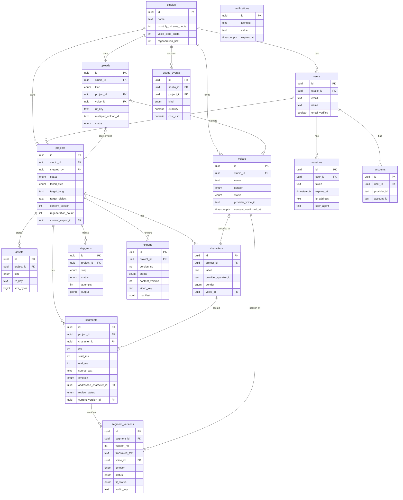
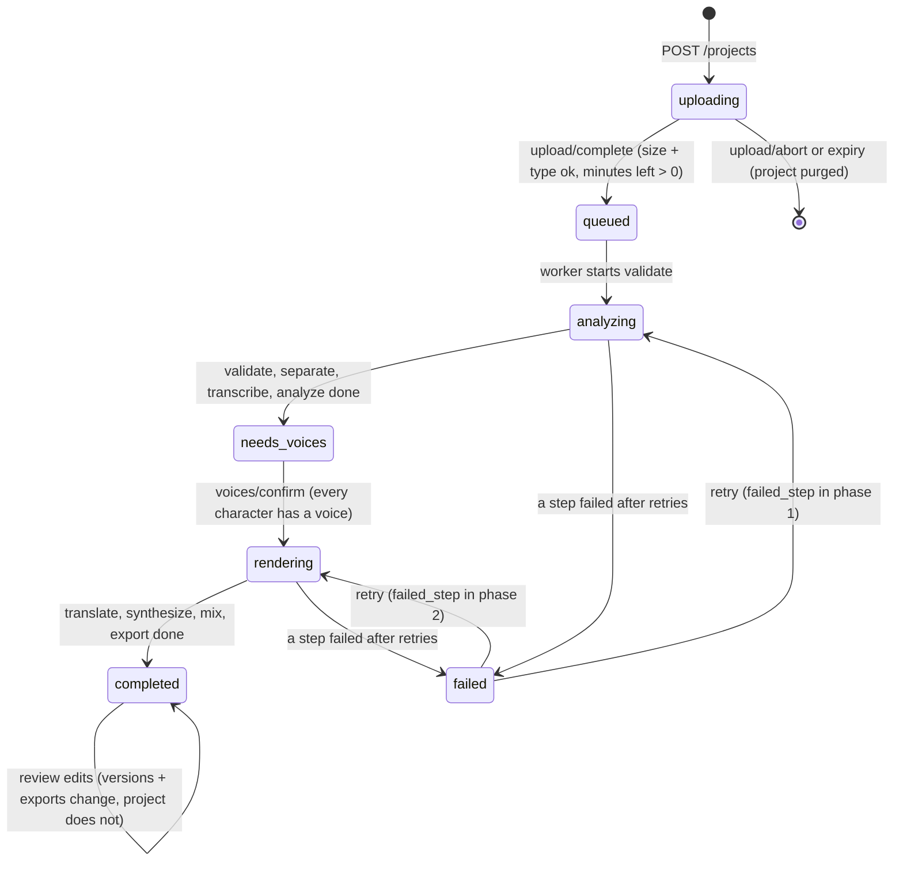

# Dubbio — 02 Database schema

Stack: PostgreSQL 16, Prisma. Names below are the physical names (snake_case); Prisma models map to them with `@map`/`@@map`. JSON in the API and job payloads uses the same names.

## 1. ERD



## 2. Enums (Postgres native enums via Prisma)

| Enum | Values |
|---|---|
| `project_status` | `uploading, queued, analyzing, needs_voices, rendering, completed, failed` |
| `pipeline_step` | `validate, separate, transcribe, analyze, translate, synthesize, mix, export` |
| `step_run_status` | `pending, running, done, failed` |
| `voice_status` | `pending, cloning, ready, failed, deleting` |
| `voice_gender` | `male, female` |
| `character_gender` | `male, female, unknown` |
| `upload_kind` | `project_video, voice_sample` |
| `upload_status` | `pending, completed, aborted, expired` |
| `asset_kind` | `source_video, voice_track, background_track, transcript, dubbed_track` |
| `version_status` | `pending, generating, ready, failed` |
| `fit_status` | `ok, too_long` |
| `version_reason` | `initial, edit, character_voice_change` |
| `review_status` | `pending, approved, rejected` |
| `export_status` | `pending, rendering, ready, failed` |
| `export_trigger` | `pipeline, regeneration, revert, manual` |
| `emotion` | `neutral, happy, sad, angry, fearful, surprised` |
| `usage_kind` | `video_minutes, separation_seconds, stt_seconds, llm_tokens, tts_characters, export_render` |

Adding a value is an `ALTER TYPE … ADD VALUE` migration; Prisma generates it. Native enums were chosen over `text + CHECK` because Prisma gives typed clients for free and the values change rarely.

## 3. Conventions

- Primary keys: `uuid` default `gen_random_uuid()`. Cursor pagination orders by `(created_at, id)`.
- Every mutable table has `created_at timestamptz not null default now()` and `updated_at timestamptz not null default now()` (updated by Prisma `@updatedAt`). Listed once here, not repeated below.
- Authentication tables (`users`, `sessions`, `accounts`, `verifications`) are owned by better-auth (Prisma adapter, Email OTP plugin). Ids come from `advanced.database.generateId: "uuid"`, so they are `uuid` like every other key and the foreign keys below stay `uuid`. Application code never writes these tables directly: it goes through better-auth and its `user.create.before` database hook (§4.2). The Prisma models keep the adapter's names (`user`, `session`, `account`, `verification`) and map to the plural table names with `@@map`; columns are snake_case via `@map`. The Prisma definition of these four models is generated with the better-auth CLI, reviewed, and then migrated with Prisma Migrate like every other model.
- Tenant column: every studio-owned row carries `studio_id`. Child rows of a project (`assets`, `characters`, `segments`, `segment_versions`, `step_runs`, `exports`) reach the tenant through `projects.studio_id`; the API always loads the project first (scoped by `studio_id` of the session user) and reads children by `project_id`.
- Soft delete (`deleted_at`) only on `projects` and `voices`. Everything else hard-deletes by cascade.
- Files live in R2; the database stores keys only (§7).

## 4. Tables

### 4.1 `studios`

| column | type | constraints | notes |
|---|---|---|---|
| id | uuid | PK | |
| name | text | not null | |
| monthly_minutes_quota | int | not null default 60 | source-video minutes per calendar month |
| voice_slots_quota | int | not null default 10 | live voices (not `failed`, not deleted) |
| regeneration_limit | int | not null default 50 | copied into `projects.regeneration_limit` at project creation |
| settings | jsonb | not null default `{}` | misc tunables; no schema yet |

Delete: not supported in MVP.

### 4.2 `users`

better-auth `user` model plus one additional field.

| column | type | constraints | notes |
|---|---|---|---|
| id | uuid | PK | generated by better-auth (`generateId: "uuid"`) |
| studio_id | uuid | FK → studios, not null, `ON DELETE RESTRICT` | better-auth additional field (`type: string`, `input: false`); supplied by the `user.create.before` hook, so it is not `required` at the better-auth layer while the column is `NOT NULL` |
| email | text | not null, unique | stored lowercase by better-auth |
| email_verified | boolean | not null default false | set by better-auth after a successful OTP sign-in |
| name | text | not null | the hook defaults it to the local part of the email |
| image | text | null | unused |

Indexes: unique `(email)`, `(studio_id)`.
Studio creation: `databaseHooks.user.create.before` calls `studios.domain.StudioProvisioner`, which inserts a `studios` row (name `"{name}'s studio"`, default quotas) and returns the user payload with `studio_id` and `name`. The studio exists before the user insert, so `studio_id` stays `NOT NULL`; if the user insert then fails, an empty studio is left behind, which is harmless. One user per studio is an application rule, not a constraint, so teams need no migration later.
Delete: users are never deleted in MVP (better-auth account deletion stays disabled).

### 4.3 `sessions`

better-auth `session` model. Cookie sessions are stored in Postgres.

| column | type | constraints | notes |
|---|---|---|---|
| id | uuid | PK | |
| user_id | uuid | FK → users, not null, `ON DELETE CASCADE` | |
| token | text | not null, unique | session token carried by the cookie |
| expires_at | timestamptz | not null | `now() + 30 days` at creation; pushed forward by better-auth at most once per day (`updateAge`) |
| ip_address | text | null | |
| user_agent | text | null | |

Indexes: unique `(token)`, `(user_id)`. Dubbio runs no cleanup job for this table.

### 4.4 `accounts` and `verifications`

`accounts` (better-auth `account`). Required by the adapter; with Email OTP as the only sign-in method (no password, no OAuth) it holds nothing in MVP.

| column | type | constraints | notes |
|---|---|---|---|
| id | uuid | PK | |
| user_id | uuid | FK → users, not null, `ON DELETE CASCADE` | |
| account_id | text | not null | provider-assigned id |
| provider_id | text | not null | |
| access_token, refresh_token, id_token | text | null | |
| access_token_expires_at, refresh_token_expires_at | timestamptz | null | |
| scope | text | null | |
| password | text | null | |

Indexes: `(user_id)`.

`verifications` (better-auth `verification`). Holds pending email OTPs; read and written only by better-auth.

| column | type | constraints | notes |
|---|---|---|---|
| id | uuid | PK | |
| identifier | text | not null | set by the Email OTP plugin |
| value | text | not null | the OTP, hashed (`storeOTP: "hashed"`); attempt tracking is internal to the plugin |
| expires_at | timestamptz | not null | `now() + 300 s` |

Indexes: `(identifier)`. No foreign keys.

### 4.5 `voices`

| column | type | constraints | notes |
|---|---|---|---|
| id | uuid | PK | |
| studio_id | uuid | FK → studios, not null, `ON DELETE RESTRICT` | |
| created_by | uuid | FK → users, not null, `ON DELETE RESTRICT` | |
| name | text | not null | |
| description | text | null | |
| gender | voice_gender | not null | used for `characters.gender` on assignment |
| language | text | not null default `'ar'` | BCP-47 primary subtag |
| sample_key | text | not null | R2 key of the uploaded sample |
| sample_duration_ms | int | null | filled by the clone job (ffprobe) |
| provider | text | not null default `'elevenlabs'` | |
| provider_voice_id | text | null, unique | set when cloning succeeds |
| status | voice_status | not null default `'pending'` | §5.3 |
| error | text | null | last failure |
| consent_speaker_name | text | not null | the person whose voice it is |
| consent_confirmed_at | timestamptz | not null | the user attested the speaker's consent |
| consent_document_key | text | null | optional signed consent form in R2 |
| deleted_at | timestamptz | null | soft delete |

Indexes: `(studio_id, status)`; unique `(studio_id, lower(name)) WHERE deleted_at IS NULL`.
Delete: soft. `DELETE /voices/:id` sets `status = deleting`; the worker deletes the provider voice, then sets `deleted_at`. Rows are never hard-deleted in MVP because `segment_versions.voice_id` references them.

### 4.6 `uploads`

| column | type | constraints | notes |
|---|---|---|---|
| id | uuid | PK | |
| studio_id | uuid | FK → studios, not null, `ON DELETE RESTRICT` | |
| kind | upload_kind | not null | |
| project_id | uuid | FK → projects, null, `ON DELETE CASCADE` | set for `project_video` |
| voice_id | uuid | FK → voices, null, `ON DELETE SET NULL` | set after the voice row is created |
| r2_key | text | not null | target object key |
| content_type | text | not null | |
| expected_size_bytes | bigint | not null | client-declared, verified on complete |
| multipart_upload_id | text | null | R2 `UploadId`; null for single PUT |
| part_size_bytes | int | null | 10 MiB fixed for video |
| part_count | int | null | |
| status | upload_status | not null default `'pending'` | |
| expires_at | timestamptz | not null | 24 h; cleanup job aborts and marks `expired` |
| completed_at | timestamptz | null | |

Check: `(kind = 'project_video' AND project_id IS NOT NULL) OR kind = 'voice_sample'`.
Indexes: `(project_id)`, `(status, expires_at)`.
Why a table: multipart state (`UploadId`, part size) must survive a page reload so the client can resume; expired uploads must be aborted on R2 or they are billed.

### 4.7 `projects`

| column | type | constraints | notes |
|---|---|---|---|
| id | uuid | PK | |
| studio_id | uuid | FK → studios, not null, `ON DELETE RESTRICT` | |
| created_by | uuid | FK → users, not null, `ON DELETE RESTRICT` | |
| title | text | not null | defaults to the file name |
| status | project_status | not null default `'uploading'` | §5.1 |
| failed_step | pipeline_step | null | set with `status = failed` |
| error | text | null | user-readable last error |
| source_lang | text | not null default `'en'` | |
| target_lang | text | not null default `'ar'` | |
| target_dialect | text | null | e.g. `'msa'`, `'egy'`; MVP: null = MSA |
| duration_ms | int | null | from `validate` (ffprobe) |
| source_meta | jsonb | null | ffprobe summary: codec, width, height, fps, audio channels |
| context | jsonb | null | output of `analyze`: scene summary, dialogue graph; unstable research output |
| render_settings | jsonb | null | snapshot at voice confirmation: `{tts_model, fit_max_speed, emotion_enabled}` |
| content_version | int | not null default 0 | incremented whenever any segment's `current_version_id` changes |
| regeneration_count | int | not null default 0 | TTS-costing regenerations used |
| regeneration_limit | int | not null | copied from the studio at creation |
| current_export_id | uuid | FK → exports, null, `ON DELETE SET NULL` | latest `ready` export; FK added in a later migration (circular) |
| completed_at | timestamptz | null | first time `completed` was reached |
| deleted_at | timestamptz | null | soft delete |

Indexes: `(studio_id, created_at desc) WHERE deleted_at IS NULL`; `(status) WHERE status IN ('queued','analyzing','rendering')` for the queue dashboard and stuck-job sweeps.
Delete: soft. `DELETE /projects/:id` sets `deleted_at` and enqueues `project.purge`, which deletes every R2 object under the project prefix (§7) and then hard-deletes the row; cascades remove assets, uploads, characters, segments, versions, step_runs and exports. `usage_events.project_id` is `SET NULL` so usage history survives.

Regeneration limit enforcement (atomic, no race):
`UPDATE projects SET regeneration_count = regeneration_count + :n WHERE id = :id AND regeneration_count + :n <= regeneration_limit` — zero rows updated means the limit is reached.

### 4.8 `assets`

| column | type | constraints | notes |
|---|---|---|---|
| id | uuid | PK | |
| project_id | uuid | FK → projects, not null, `ON DELETE CASCADE` | |
| kind | asset_kind | not null | |
| r2_key | text | not null | |
| content_type | text | not null | |
| size_bytes | bigint | not null | |
| duration_ms | int | null | audio/video kinds |
| meta | jsonb | null | e.g. sample rate, channels |

Unique `(project_id, kind)`. Each kind is a singleton per project; a step that re-runs overwrites the same key and updates the row (idempotent). Final MP4s are in `exports`, segment audio in `segment_versions`, because those are versioned and this table is not.

### 4.9 `characters`

| column | type | constraints | notes |
|---|---|---|---|
| id | uuid | PK | |
| project_id | uuid | FK → projects, not null, `ON DELETE CASCADE` | |
| label | text | not null | user-editable; default `Speaker N` |
| provider_speaker_id | text | not null | diarization label from STT |
| gender | character_gender | not null default `'unknown'` | set from `voices.gender` on assignment |
| voice_id | uuid | FK → voices, null, `ON DELETE SET NULL` | assigned in `needs_voices`; changed later only through the review module |
| sort_order | int | not null | by first appearance |
| analysis | jsonb | null | LLM guesses from `analyze`: `{gender_guess, role, confidence}` |

Unique `(project_id, provider_speaker_id)`; index `(project_id, sort_order)`.
Delete: cascade from project. Merge (API) reassigns the source character's segments to the target, then deletes the source row; allowed only in `needs_voices`.

### 4.10 `segments`

| column | type | constraints | notes |
|---|---|---|---|
| id | uuid | PK | |
| project_id | uuid | FK → projects, not null, `ON DELETE CASCADE` | |
| character_id | uuid | FK → characters, not null, `ON DELETE RESTRICT` | merge reassigns before deleting a character |
| idx | int | not null | 0-based order by `start_ms` |
| start_ms | int | not null | from STT; immutable |
| end_ms | int | not null, check `end_ms > start_ms` | |
| source_text | text | not null | |
| emotion | emotion | not null default `'neutral'` | from `analyze`; fallback neutral |
| addressee_character_id | uuid | FK → characters, null, `ON DELETE SET NULL` | from `analyze`; drives Arabic 2nd-person gender |
| analysis | jsonb | null | raw `analyze` output for this segment (candidates, confidence) |
| current_version_id | uuid | FK → segment_versions, null, `ON DELETE SET NULL` | last `ready` version; FK added in a later migration (circular) |
| review_status | review_status | not null default `'pending'` | reset to `pending` whenever `current_version_id` changes |
| review_note | text | null | reviewer comment |
| reviewed_at | timestamptz | null | |

Unique `(project_id, idx)`; index `(character_id)`.
The segment has no `status` column: its state is derived from its versions (§5.4). Two columns for one fact drift.

### 4.11 `segment_versions`

| column | type | constraints | notes |
|---|---|---|---|
| id | uuid | PK | |
| segment_id | uuid | FK → segments, not null, `ON DELETE CASCADE` | |
| version_no | int | not null | 1 = pipeline output |
| translated_text | text | not null, check `length <= 500` | content (immutable) |
| voice_id | uuid | FK → voices, not null, `ON DELETE RESTRICT` | content (immutable); resolved from the character at creation |
| emotion | emotion | not null | content (immutable) |
| reason | version_reason | not null | `initial`, `edit`, `character_voice_change` |
| batch_id | uuid | null | groups the N versions of one character voice change |
| created_by_user_id | uuid | FK → users, null, `ON DELETE SET NULL` | null for pipeline |
| status | version_status | not null default `'pending'` | §5.4 |
| attempts | int | not null default 0 | |
| error | text | null | |
| job_id | text | null | BullMQ job id, for the dashboard |
| audio_key | text | null | R2 key of the fitted audio |
| raw_duration_ms | int | null | TTS output before fitting |
| fitted_duration_ms | int | null | after `atempo` |
| speed_factor | numeric(5,3) | null | applied tempo factor; 1.000 = untouched |
| fit_status | fit_status | null | set when `ready` |
| tts_model | text | null | model actually used |
| tts_characters | int | null | billed characters; also written to `usage_events` |
| generated_at | timestamptz | null | |

Unique `(segment_id, version_no)`; index `(segment_id, created_at desc)`; partial index `(status) WHERE status IN ('pending','generating')` (in-flight lookups); index `(batch_id)`.
Rules:
- Content columns never change. Audio and status columns do. Retrying a failed version regenerates audio for the same row (idempotent key = version id).
- A version becomes `current_version_id` on its segment only when it reaches `ready`; the previous current stays playable until then.
- Undo = set `current_version_id` to an older `ready` version. No TTS, so it is not counted in `regeneration_count`.

### 4.12 `step_runs`

| column | type | constraints | notes |
|---|---|---|---|
| id | uuid | PK | |
| project_id | uuid | FK → projects, not null, `ON DELETE CASCADE` | |
| step | pipeline_step | not null | |
| status | step_run_status | not null default `'pending'` | §5.2 |
| attempts | int | not null default 0 | |
| started_at | timestamptz | null | |
| finished_at | timestamptz | null | |
| error | text | null | |
| output | jsonb | null | small summary only: counts, keys, `fallback: true`; never payloads |
| job_id | text | null | BullMQ job id |

Unique `(project_id, step)`. Eight rows are created when the project is queued, so progress UIs can render all steps before any runs. The pipeline only (segment regenerations and re-exports are tracked on `segment_versions` and `exports`).

### 4.13 `exports`

| column | type | constraints | notes |
|---|---|---|---|
| id | uuid | PK | |
| project_id | uuid | FK → projects, not null, `ON DELETE CASCADE` | |
| version_no | int | not null | 1 = pipeline export |
| trigger | export_trigger | not null | |
| triggered_by_user_id | uuid | FK → users, null, `ON DELETE SET NULL` | |
| content_version | int | not null | `projects.content_version` at enqueue time |
| manifest | jsonb | not null | `{ "<segment_id>": "<version_id>", ... }` used in this render |
| status | export_status | not null default `'pending'` | §5.5 |
| attempts | int | not null default 0 | |
| error | text | null | |
| job_id | text | null | |
| video_key | text | null | R2 key, set when `ready` |
| size_bytes | bigint | null | |
| finished_at | timestamptz | null | |

Unique `(project_id, version_no)`; index `(project_id, status)`.
`projects.current_export_id` always points to the newest `ready` export. Stale check: `projects.content_version > exports.content_version` of the current export.

### 4.14 `usage_events`

| column | type | constraints | notes |
|---|---|---|---|
| id | uuid | PK | |
| studio_id | uuid | FK → studios, not null, `ON DELETE RESTRICT` | |
| project_id | uuid | FK → projects, null, `ON DELETE SET NULL` | history survives project purge |
| voice_id | uuid | FK → voices, null, `ON DELETE SET NULL` | for clone events |
| kind | usage_kind | not null | |
| quantity | numeric(14,3) | not null | minutes, seconds, tokens, characters, or 1 per render |
| provider | text | null | `elevenlabs`, `llm`, `demucs`, `ffmpeg` |
| cost_usd | numeric(10,4) | null | estimate from a config price table; null when unknown |
| meta | jsonb | null | model name, step, version id |
| occurred_at | timestamptz | not null default now() | |

Indexes: `(studio_id, occurred_at)`, `(project_id)`.
Quota check (monthly minutes): `SUM(quantity) WHERE studio_id = :s AND kind = 'video_minutes' AND occurred_at >= date_trunc('month', now())` compared with `studios.monthly_minutes_quota`. Written once per project by the `validate` step (before any paid call). Global spend cap: same sum over `cost_usd` across all studios, compared with an environment value; a scheduled job alerts at 80 %. A monthly rollup table is deferred until the sum is measurably slow.

## 5. State machines

### 5.1 Project



Rules: `failed_step` and `error` are set on `failed` and cleared on retry. `validate` may also fail the project with `error = quota_exceeded`. Soft delete is allowed from any status; an in-flight job sees `deleted_at` and stops.

### 5.2 Step run

`pending → running → done | failed`; `failed → running` on retry with `attempts + 1`. The optional `analyze` step never ends `failed`: after its retries it ends `done` with `output.fallback = true` and neutral emotions.

### 5.3 Voice

`pending → cloning → ready | failed`; `failed → cloning` on retry; `ready → deleting → (deleted_at set)`. A voice is usable only when `ready`. Deleting is refused (409) while any `segment_versions` row using it is `pending/generating` or any project assigning it is `rendering`.

### 5.4 Segment version, and the derived segment state

Version: `pending → generating → ready | failed`; `failed → generating` on retry. `fit_status` is set together with `ready`.

Derived segment `state` (computed in the API, not stored):

| state | rule |
|---|---|
| `pending` | no versions yet (before `translate`) |
| `translated` | has a version, none `ready`, none in flight (`translate` done, `synthesize` not started) |
| `generating` | no `ready` version and one is `pending/generating` |
| `regenerating` | has a current `ready` version and a newer one is `pending/generating` |
| `ready` | current version `ready` with `fit_status = ok`, nothing in flight |
| `too_long` | current version `ready` with `fit_status = too_long` |
| `failed` | newest version `failed`, nothing in flight |

`review_status` is independent of `state` and resets to `pending` whenever `current_version_id` changes.

### 5.5 Export

`pending → rendering → ready | failed`; `failed → rendering` on retry. On `ready`: set `projects.current_export_id`, keep older exports for 7 days then delete their objects (cleanup job). At most one export per project is `pending/rendering` at a time; a new request while one is in flight is coalesced (details in 04-queue).

## 6. Design decisions

- **Versions instead of in-place edits.** The reviewer needs undo and a diff between what the pipeline produced and what was changed. Making a version the unit of generation also gives the regeneration job a natural idempotency key and makes "undo" free (audio of old versions is kept).
- **No stored segment status.** Everything a status column would say is already in the versions. Deriving it costs one small join per listing and removes a class of drift bugs.
- **`exports` table instead of a project status.** A re-render does not change where the project is in its lifecycle (§5.5); the table also gives an audit trail of what was rendered when, which a thesis evaluation will want.
- **JSONB where the shape is still research**: `projects.context`, `segments.analysis`, `characters.analysis`, `step_runs.output`, `source_meta`, `render_settings`. Columns are promoted only when a query needs them (`emotion`, `addressee_character_id`, `duration_ms` are already promoted). Nothing the API filters or sorts by lives in JSONB.
- **Soft delete only where files or history hang off the row** (projects, voices). Purging R2 can fail halfway; soft delete makes the purge retryable and keeps the row until the files are gone.
- **Multi-tenancy by `studio_id` column + application scoping**, no Postgres RLS in MVP: one database role, Prisma, four developers; RLS adds a second place where the rule can be wrong. Every repository method takes `studio_id` as the first argument; a test asserts that every tenant table has it.
- **Authentication delegated to better-auth.** Sessions, one-time codes and their hashing are not ours to maintain. The only coupling is `users.studio_id`, so the tenant travels with the session and every request knows its `studio_id` without an extra lookup.
- **Usage as an append-only event log**, not counters: counters cannot be audited or re-priced; the monthly sum is tiny at MVP scale.
- **UUID v4 everywhere.** Time-ordered ids would help index locality later; not worth a dependency now.

## 7. R2 keys and retention

```
studios/{studio_id}/voices/{voice_id}/sample.{ext}
studios/{studio_id}/voices/{voice_id}/consent.pdf
studios/{studio_id}/projects/{project_id}/source.mp4
studios/{studio_id}/projects/{project_id}/voice.wav
studios/{studio_id}/projects/{project_id}/background.wav
studios/{studio_id}/projects/{project_id}/transcript.json
studios/{studio_id}/projects/{project_id}/dubbed.wav
studios/{studio_id}/projects/{project_id}/segments/{segment_id}/v{version_no}.mp3
studios/{studio_id}/projects/{project_id}/exports/v{version_no}.mp4
```

The project prefix makes purge a single list-and-delete. Retention (cleanup job, daily): `voice_track`, `background_track`, `dubbed_track` assets older than 30 days after `completed_at` are deleted (a later edit must re-run `separate`; acceptable and rare); audio of non-current segment versions older than 30 days is deleted and the row keeps its metadata; exports other than the current one are deleted after 7 days.

Presigned URLs: upload parts 1 h, downloads 15 min.
